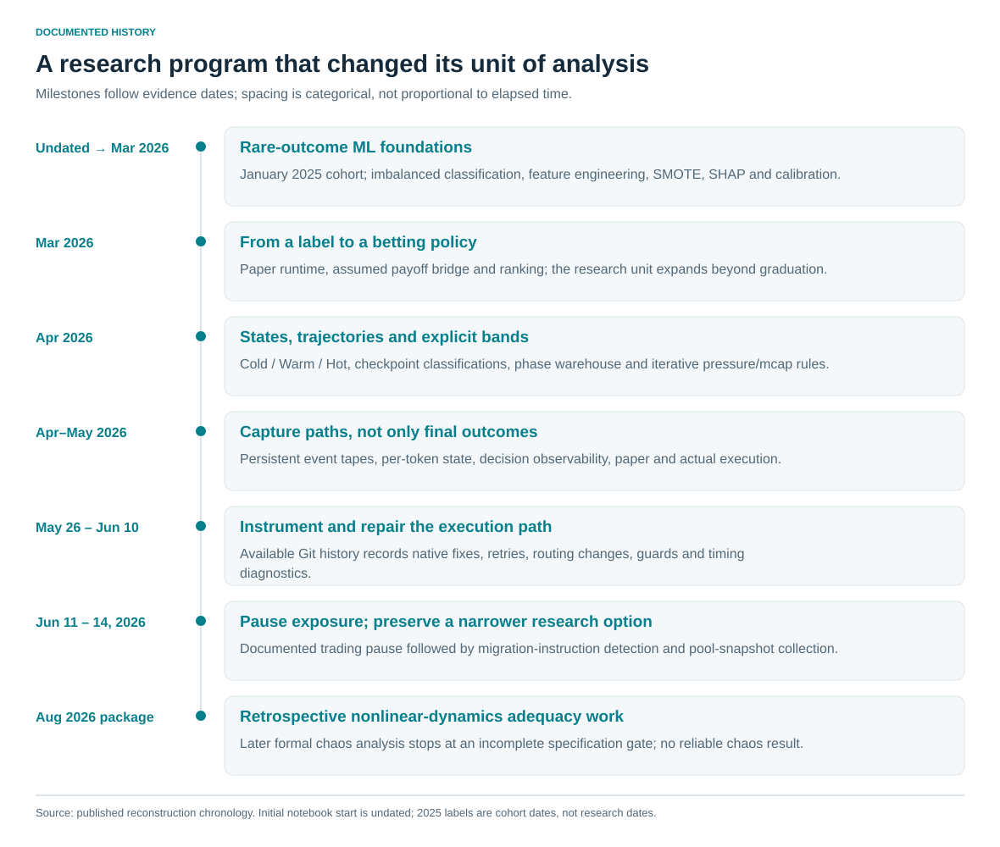
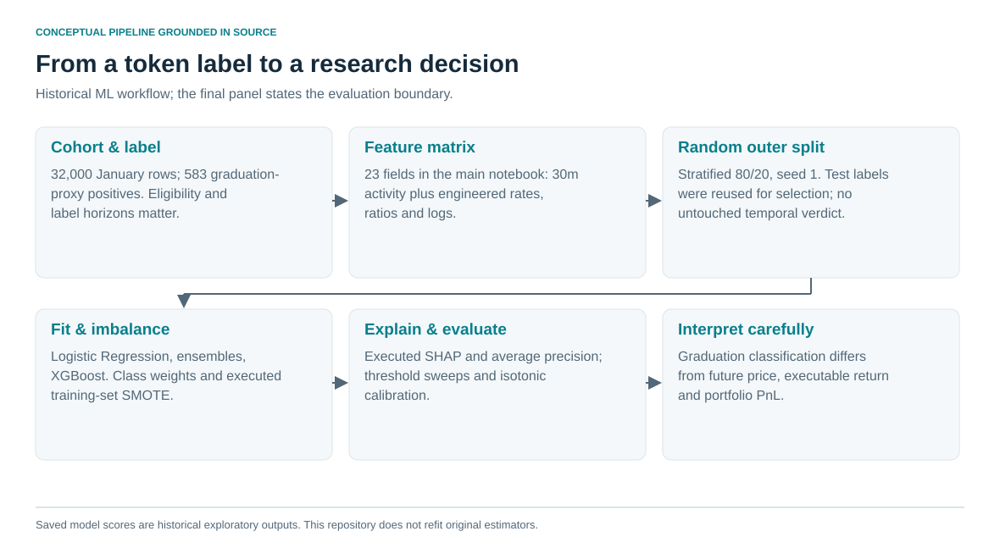
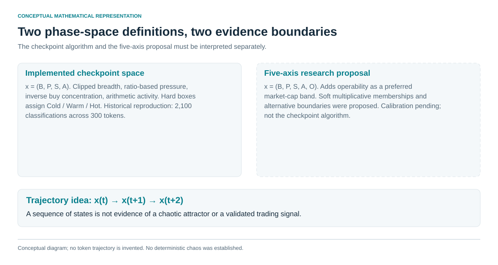
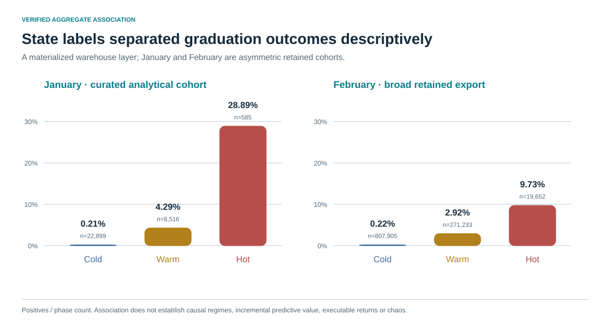
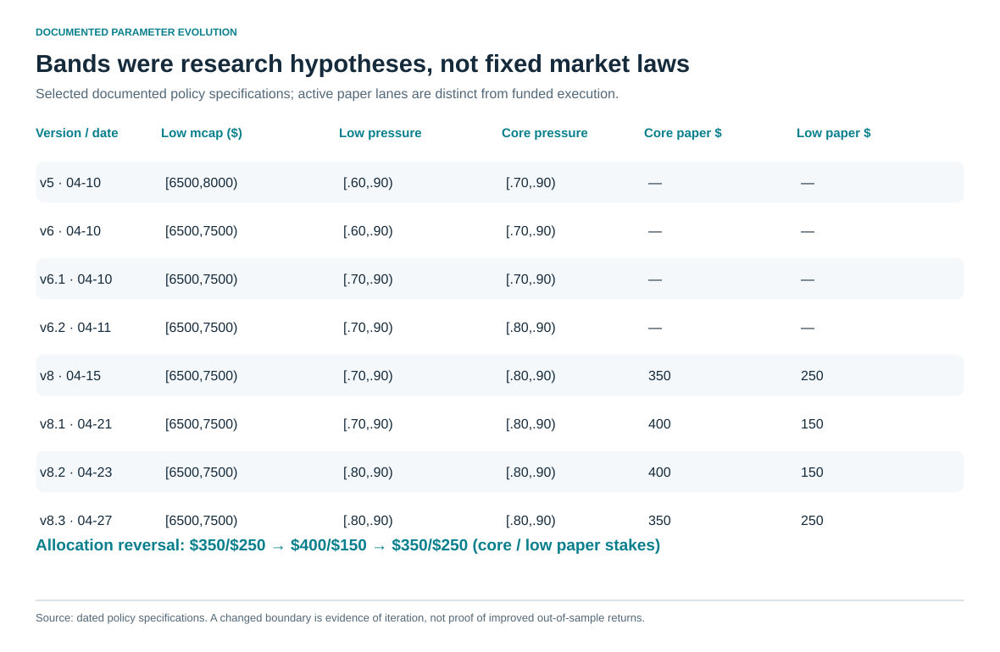
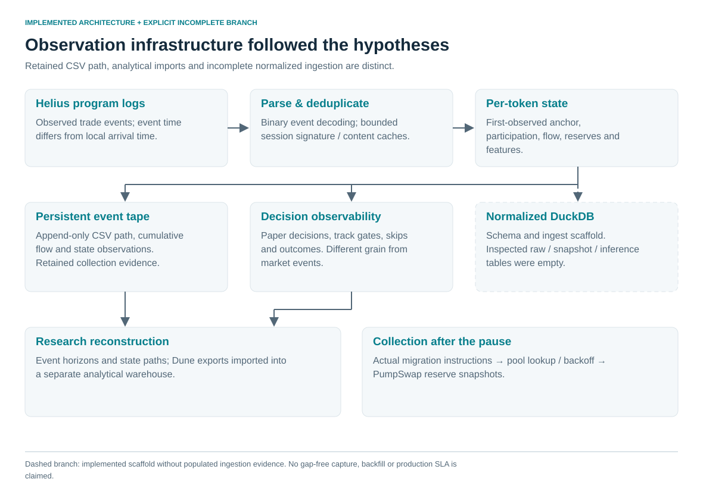
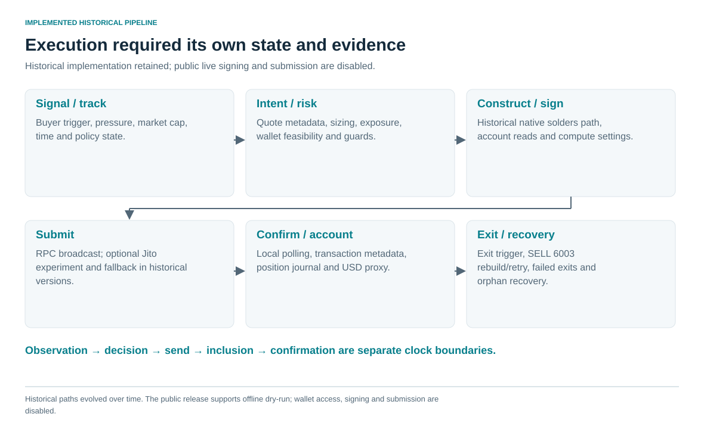
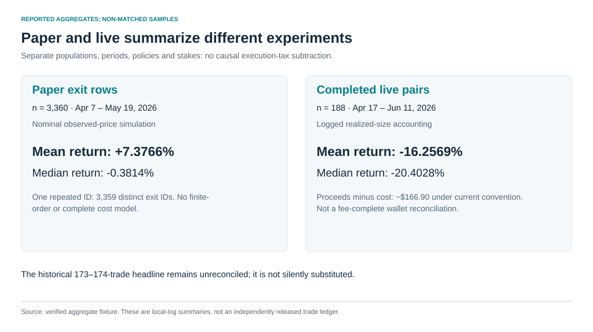
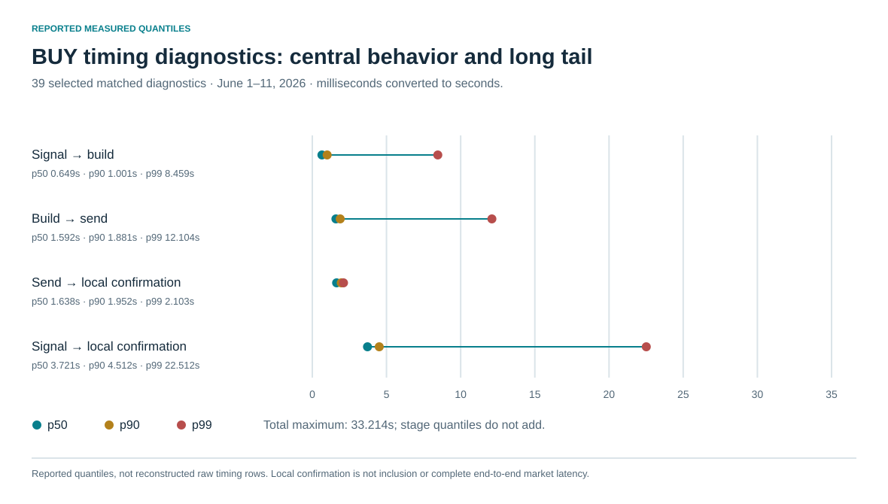
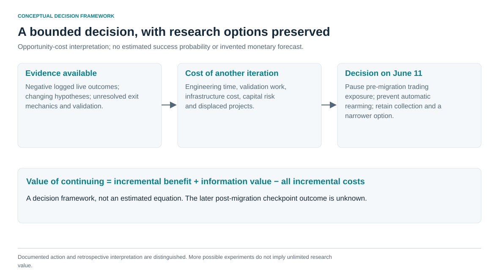

# From Machine Learning to Chaos Theory: What Building a Solana Trading System Taught Me About Markets, Data, and Execution

I began with a prediction question and ended with a much broader understanding of what a quantitative research system has to observe, represent and measure.

The project started with early-stage Pump.fun tokens on Solana. I wanted to know whether their initial activity could help identify a rare graduation outcome. The work expanded into imbalanced classification, phase-space representations, changing market hypotheses, custom event collection and actual transaction execution. The most useful results included implemented mechanisms and negative findings: what the data could distinguish, what the simulations assumed, and where the system's observations stopped supporting its conclusions.

This is a research and engineering case study. The accompanying [offline repository](README.md) reproduces aggregate arithmetic, figures and method examples. It separates those public reproductions from findings established against retained private project evidence.

**Central hypothesis.** Tokens are represented as points in multidimensional market-state space, and their evolution forms trajectories. Similarity to graduation-bound trajectories was hypothesized to add predictive information beyond static state. Chaos theory informed this approach; deterministic chaos and incremental predictive improvement were not established.

## 1. The question that started everything

New tokens supplied a concrete rare-outcome problem. Most did not reach the project's historical graduation proxy, described as approximately $69,000 market capitalization. Could early trading activity help distinguish those that would?

The retained January 2025 analytical cohort contained **32,000 rows and 583 positive labels**, a prevalence of 1.821875%. January is the data-cohort date, not the date the research began; the initial notebook's exact start is undated. Paper-runtime evidence is present by March 2026. [E01–E08](docs/claim_register.md#e01)

At this prevalence, a classifier that always said “no” would achieve 98.178125% accuracy. The interesting questions concerned positive-class precision, recall, ranking and the information available before a decision.

I initially treated graduation as a tractable endpoint. Later work made its definition more consequential. A market-cap threshold is not identical to an actual migration instruction, and an ever-crossed label is not necessarily a future event relative to a 30-minute feature snapshot. Eligibility filters, observation horizons and censoring determine what a model is actually learning.

The research gradually changed its unit of analysis: first a token, then an early feature snapshot, then a state and trajectory, then a policy decision, an execution attempt and an economic outcome. That progression explains much of the software that followed.

## 2. Building the first ML model

I constructed activity and participation features: volume, trade count, distinct buyers and sellers, buy/sell measures, maximum and average trade size, wallet concentration and launch-time fields. Ratios, rates and log transforms expanded the feature set. The main notebook's model matrix had 23 columns.

The source data also contained two-hour aggregates. They were absent from that particular 23-column matrix, although another evaluation script used a different feature list containing two-hour fields. This distinction matters: a column existing in a dataset does not make it available to an earlier decision. Ten-minute observations were more clearly evidenced later as state checkpoints and outcome horizons than as a uniform initial ML feature window.

I tested Logistic Regression, tree ensembles and XGBoost. I used class weighting and then SMOTE on the training split, refitted models, examined SHAP explanations and evaluated average precision. These methods were actually executed, rather than merely mentioned in imports. The notebook called the implemented `average_precision_score` “PR-AUC.” [E03–E06](docs/claim_register.md#e03)

| Historical saved baseline | Recall | Precision | Average precision |
|---|---:|---:|---:|
| Logistic Regression | .863 | .269 | .526 |
| Gradient Boosting | .667 | .951 | .812 |
| XGBoost | .667 | .765 | .782 |

These are saved exploratory outputs. The public repository does not refit the original models, release their training records or load historical serialized estimators.

The evaluation design was also exploratory. The outer split was stratified random, 80/20, with seed 1. I reused the test labels while comparing models, searching thresholds and adding structural filters. Later tuning used three-fold CV; isotonic calibration was fitted on balanced data. That left important differences between an encouraging within-cohort result and an untouched temporal evaluation. Resampling and calibration also needed their own fold and prevalence boundaries.

A second issue was semantic consistency. A trade-count buy/sell ratio, a volume ratio and a buy-volume share are different features. Buy-only concentration is different from concentration across both sides. Some historical descriptions and runtime builders used similar names for different definitions. Better modeling could not compensate for an input contract that changed meaning between sources.

## 3. Why classification was not enough

The first conceptual correction was separating four targets:

| Target | Question |
|---|---|
| Graduation | Will a historical outcome label become positive? |
| Future price path | What happens to price after a defined information boundary? |
| Executable return | What can a finite order capture after delay, costs and liquidity constraints? |
| Portfolio result | What remains after position sizing, failures, capital limits and accounting? |

The early betting bridge used an explicit assumed expectation:

$$EV(p)=2.84p-.85(1-p).$$

This made the assumptions inspectable. It also revealed the missing connection: a graduation probability was being combined with fixed payoff and loss estimates. The expression did not model conditional entry price, position size, changing liquidity or the ability to exit.

A token could reach the graduation proxy after an expensive entry, move favorably before the system acted, or become difficult to sell. Another could offer a short move without graduating. Classification remained a useful research foundation, but it was no longer a sufficient description of the investment hypothesis.

Ranking and explicit rules followed. The research shifted toward locating particular configurations of participation and flow, then asking whether the remaining path justified an action.

## 4. Exploring phase space and nonlinear market dynamics

The state-space idea was to stop treating a token as one number. Participation could broaden while concentration remained high. Buying pressure could look strong while the entry became late. Activity could grow without sufficient economic substance. The joint configuration, and its direction of change, seemed worth studying.

I organized the hypothesis around five concepts:

- **Breadth:** distributed buyer participation.
- **Pressure:** direction and dominance of flow.
- **Structure:** concentration and internal fragility.
- **Activity:** economic mass and trading intensity.
- **Operability:** whether a defensible entry remained accessible.

Cold, Warm and Hot provided operational language. Cold meant no defensible setup under the framework. Warm meant activation with incomplete alignment. Hot meant a region worth considering, with timing, crowding and execution still to evaluate. It did not mean an automatic purchase.

The project retained two different mathematical objects that should not be blended. The **five-axis research proposal** used a state x(t)=(B,P,S,A,O) in [0,1]^5, soft membership functions and a preferred operability band. The **four-axis checkpoint implementation** used x(t)=(B,P,S,A) with fixed inequalities. A third artifact, the materialized January/February warehouse layer, retained derived coordinates and phase labels, with generating lineage not fully recovered. [E09–E12](docs/claim_register.md#e09)

For the checkpoint implementation, define q(z)=min(1,max(0,z)). Its coordinates were:

$$B=q\left(\frac{u-20}{80}\right),\qquad
P=q(r-1),\qquad
S=1-q\left(\frac{c-.20}{.30}\right),$$

$$A=.5q\left(\frac{v-1000}{9000}\right)
  +.3q\left(\frac{n-20}{180}\right)
  +.2q\left(\frac{a-20}{100}\right).$$

The raw variables were distinct buyers u, checkpoint buy/sell ratio r, top-wallet buy-volume share c, total USD volume v, trade count n and mean USD size a.

Hot required B≥.60, P≥.35, S≥.40 and A≥.35. Cold required B≤.20, P≤.20 and A≤.25. Everything else was Warm. The implementation therefore embodied a conjunction of dimensions rather than a single score threshold. It also had a data-quality consequence: missing comparisons could land in residual Warm. The public implementation preserves the rule while flagging missing inputs.

The private reconstruction reproduced **all 2,100 checkpoint classifications across 300 tokens**, observed at 1,3,5,10,15,20,30 minutes. Those unequal intervals are not interchangeable time steps. Transition counts and early/late Hot archetypes described the sample; seven points per token could not support attractor reconstruction. [E10](docs/claim_register.md#e10)

The five-axis proposal explored a different geometry. One candidate Hot membership was:

$$H(x)=B^{.25}P^{.30}S^{.15}A^{.20}O^{.10}.$$

Multiplication penalized configurations with one very weak component. Operability used a proposed trapezoid around $10k,$14k,$22k,$30k market-cap knots; pressure could use normalized buy-volume share, and activity could be geometric. These were explicit modeling choices in a calibration-pending specification, not discovered laws or the checkpoint algorithm.

## 5. Formulating and revising investment hypotheses

The central trajectory hypothesis was **Cold→Warm→Hot**: early activation becomes sufficiently aligned before the opportunity is exhausted. **Warm→Cold** represented failed activation. **Hot→Warm/Cold** represented deterioration.

That suggested several related questions. Did time-to-Hot matter? Could a concentrated Hot state be more fragile than a distributed one? Was a lower-cap region earlier and more useful, or merely noisier? Could flow that looked attractive already be too expensive to enter?

The specification proposed directional displacement through the coordinates. Later runtime features used a more concrete activity proxy: distinct buyers in the most recent minute, and the difference from the preceding minute. Those counts were called velocity and acceleration, but they were not price derivatives or a measurement of sensitive dependence. Wallets could appear in both windows.

The materialized warehouse did show descriptive structure:

| Cohort | Cold graduation rate | Warm graduation rate | Hot graduation rate |
|---|---:|---:|---:|
| January, curated | .214% | 4.286% | 28.889% |
| February, broader export | .218% | 2.920% | 9.734% |

These associations reproduced from the retained warehouse. They motivated the state representation, while leaving its added predictive and trading value unresolved. January and February had different cohort construction. No completed held-out, cost-aware ablation showed that trajectories beat simpler buyer/pressure rules. [E11–E12](docs/claim_register.md#e11)

The chaos-theory inspiration needs a precise boundary. Nonlinear behavior, stochastic dynamics, regime switching and deterministic chaos are different propositions. A later retrospective package attempted a formal adequacy process, then stopped because variance-regime and downstream method parameters were incompletely frozen. It produced no reliable correlation-dimension, Lyapunov or IAAFT conclusion. **Deterministic chaos was not established.** [E23–E24](docs/claim_register.md#e23)

## 6. How bands, limits and thresholds changed

The hypotheses became explicit policy regions. April versions separated a lower-cap lane from an $8k–$9k core lane. The lower region narrowed from [$6.5k,$8k) to [$6.5k,$7.5k), with the intermediate range observed in shadow. Its buy-volume pressure floor rose from .60 to .70 and later .80; the core floor rose from .70 to .80.

These pressure shares were not the ratio-based P coordinate in the checkpoint implementation. Similar terminology should not erase different definitions.

Allocation also changed direction. On April 21, core/low nominal paper stakes moved from $350/$250 to $400/$150. On April 27 they moved back to $350/$250 after another recent paper read. That reversal records how sensitive conviction was to the observed window.

Exits and risk constraints evolved separately. Earlier 2x/10-minute ideas gave way in later policy families to 1.5x take-profit and eight-minute timeout rules. Late-May repair sizing, a $25 live pilot and a later reduction to $15 belonged to execution validation, distinct from large paper allocations. In June the fast-stop trigger tightened from −25% to −15%, followed by entry-premium and age guards.

The revisions were research iterations. Most were chosen after inspecting earlier slices, then operated prospectively. Repeated slicing by cap, pressure, time and exit family created selection and regime-dependence risks. The record does not establish that every narrower band was progress, or that the earlier operability trapezoid was calibrated into the later policy bands. [Selected specifications](research/04_hypothesis_evolution.md)

## 7. Building a custom market data collection system

The changing hypotheses created a concrete observation problem. A monthly token table could tell me an outcome and some early aggregates. It could not tell me the sequence after an anchor, when a state became visible, why a policy declined it, or what price was available during the delay before an order.

The research needed its own observation layer.

The operating path subscribed to Helius program logs, decoded binary trade events and maintained per-token observed state. An append-only CSV tape retained reserve-derived prices, cumulative participation and flow, age and timestamps. Rule-evaluation and paper-decision logs recorded what the software did with those observations. The distinction in grain was essential: a repeated rule evaluation was not another market trade.

| Hypothesis or diagnostic | Required observation | Software response |
|---|---|---|
| State alignment | Joint participation, flow, size and concentration at a checkpoint | Per-token feature state |
| Warm→Hot trajectory | Repeated observations in order | Persistent event tape and checkpoint analysis |
| Missed or skipped opportunity | Policy decision and rejection reason | Rule/decision observability |
| Entry versus exit regret | Anchor, future path and action boundaries | Outcome Engine and horizon-reconstruction work |
| Execution discrepancy | Intent, risk result, submission and realized metadata | Execution journal, state transitions and diagnostics |

The tape made later path questions possible without relying solely on final exits. It also made observation bias visible. First observed trade is not necessarily launch. Reconnection can leave incomplete early history. Second-granularity event time is not local arrival time. A reserve ratio gives marginal post-trade price, not the average price of an arbitrary order. Runtime USD values depend on the SOL/USD conversion used at observation.

Deduplication evolved through bounded session-local signature and content caches. Those reduced redelivery, while retaining limits: restart clears memory; one transaction can contain several relevant events; a same-second content tuple can collide. A clean research event identity needs more than a convenient key. The case study does not retroactively claim persistent event-index deduplication or gap-free replay.

The separate normalized DuckDB design was more explicit about units and provenance. It distinguished event, observation and ingestion timestamps, integer lamports and token units, parser/schema versions, snapshot anchors, inference and labels. But the inspected database had labels and empty raw/snapshot/inference tables. I describe that as implemented schema/integration scaffolding, while the CSV tape is the evidenced retained collection path. Architecture diagrams should preserve that difference. [E25–E27](docs/claim_register.md#e25)

Collection continued after trading paused. A later detector moved from a market-cap proxy toward actual Migrate/MigrateV2 instructions, followed by mint/pool extraction, lookup retries and PumpSwap reserve polling. Program-ID and proxy corrections belong to that engineering history. The later experiment's economic checkpoint remains unresolved; the observation mechanism itself is concrete. [E22](docs/claim_register.md#e22)

## 8. From research to trading experiments

The historical execution stack separated signal/track gates, execution intent, risk, construction/signing, submission, confirmation and position state. Native transaction work used solders primitives, account metadata and compute-budget settings. Journals and recovery tools handled denied orders, retries and orphan positions.

Modes remained different experiments. A backtest used historical assumptions; paper acted on observed-price proxies; shadow retained alternate decisions; dry-run exercised intent paths; micro-live submitted actual transactions. In some documents “live” meant an active paper lane, so that word alone did not establish funded operation.

The code evolved through instruction/parsing repairs, native SELL work, wallet feasibility, sizing consistency, parallel account reads, multiple RPC broadcasts and guards. A 1000x unit correction in an entry-premium guard is a useful example: a problem that can look like execution rejection may be a dimensional error. Correctness and market latency required different diagnoses. [E28](docs/claim_register.md#e28)

The scientific benefit of the architecture was separating intention from outcome. Selecting a token did not mean an order passed risk. Submission did not imply confirmation. A confirmed position did not imply a successful exit. Each boundary needed its own evidence.

## 9. Paper results versus real execution

The original paper v2 file contained **3,360 final exit rows, including one duplicate ID**. A last-exit rule leaves 3,359 distinct IDs. The raw-row mean return was +7.3766%, median −0.3814% and positive fraction 49.6429%. Nominal stakes and policy versions changed across the sample. [E13–E14](docs/claim_register.md#e13)

The positive mean and slightly negative median show why the payoff distribution mattered. They do not turn the paper dollar total into earned or attainable profit. The simulation did not provide a complete finite-order cost model; a separate haircut field was not equivalent to a realistic net fill ledger.

The current reconstruction finds **188 completed live BUY/SELL pairs**, April 17–June 11, with logged proceeds minus cost totaling **−$166.90** under the reconstructed USD convention. Two filled buys remain unmatched. Wallet deltas, contemporary SOL/USD conversion, fees, rent, refunds and fallbacks prevent treating that total as a complete fee-clean wallet reconciliation. [E15](docs/claim_register.md#e15)

The historical 173–174-trade headline does not fully reconcile with this reconstruction. It remains disclosed as a historical reporting limit, rather than being silently substituted for the current result. Repeated failed SELL rows are also a different unit from independent failed trades. [E16](docs/claim_register.md#e16), [E19](docs/claim_register.md#e19)

Paper and live differ in dates, sizes, rules, arming and selection. Their difference cannot be labeled a causal execution tax. The observation is narrower and still important: positive nominal simulations did not describe the negative logged outcomes of actual execution.

## 10. Infrastructure, latency and competition

The available BUY diagnostic file contains **39 selected matched rows**. Median signal-to-local-confirmation latency is **3.721 seconds**, p90 4.512 seconds, interpolated p99 22.512 seconds and maximum 33.214 seconds. The endpoint is local confirmation, even though the original field was named `signal_to_fill_ms`. [E17](docs/claim_register.md#e17)

Those measurements give the execution discussion a real scale and a visible tail. They do not supply complete event propagation, inclusion, computation or SELL distributions. Stage quantiles do not add, and a p99 from 39 selected rows is descriptive rather than a stable reliability guarantee.

The closeout describes SELL error 6003 causing rebuilds against refreshed curve state during collapses. The mechanism can add delay precisely when a rapidly changing exit matters. It is a concrete engineering problem, without a complete controlled estimate of its contribution to all losses.

A Jito submission experiment and timeout/fallback changes appear in the history, followed by disabling that path. This is evidence about the local implementation, not a general benchmark of a provider. Similarly, the logged absolute price-deviation proxy mixes favorable and adverse changes; it cannot simply be called adverse slippage and subtracted again from outcomes. [E18](docs/claim_register.md#e18), [E20](docs/claim_register.md#e20)

Competition was part of my interpretation of the environment. My informal 90% / 8% / 1% hierarchy expressed the idea that substantial technical improvement could still leave a system behind a much smaller set of specialists. It was not a measured profitability distribution. The project did not establish market-wide concentration, a particular MEV explanation or superiority over other participants. [E32](docs/claim_register.md#e32)

Infrastructure mattered alongside selection, liquidity, fees, simulation assumptions and code defects. The evidence does not isolate one as the sole explanation or establish that faster hardware would have produced profitability.

## 11. The economics of continuing research

There was always another experiment: a pressure boundary, a time filter, an alternative trajectory feature, an exit rule, a different observation path or a faster submission mechanism. The existence of additional experiments was not the same as a reason to keep funding all of them.

A useful decision framework is:

$$V_{continue}=E[\Delta benefit]+V_{information}
 -C_{engineering}-C_{infrastructure}-C_{capital\ risk}-C_{opportunity}.$$

This is a conceptual accounting of the decision, not an estimated equation. The records do not establish a precise lifetime hours total, optimal stopping date or expected financial value. Hypothetical infrastructure scenarios are not controlled measured upgrades.

The relevant question became whether another iteration had enough expected value to justify its validation and implementation cost. The research had already shown that a better description of tokens and a more capable execution system were separate achievements, neither sufficient by itself to justify scaling.

## 12. Why I decided to pause

On **June 11, 2026**, the trading gate closed and a watchdog change prevented automatic rearming. Data collection continued, with a narrower post-migration research option. That distinction is documented and important. [E21–E22](docs/claim_register.md#e21)

I paused exposure because further experimentation and infrastructure work no longer appeared justified by the incremental benefits relative to the capital and attention I was prepared to commit. It was an allocation decision under uncertainty, not a claim that no hypothesis remained or that every execution architecture had been ruled out.

Preserving collection kept a narrower option open without continuing the same trading exposure. The proposed later checkpoint's outcome remains unknown in the retained reconstruction. I do not rewrite it into a verdict about all Solana research.

## 13. What I learned

The most durable lesson was to define the information boundary before the feature, and the economic target before connecting a classifier to a policy. A label, a state and an order outcome each need their own unit of observation.

The second was architectural: retain the evidence required by the hypothesis. Final trade exits cannot reconstruct skipped candidates; a static cohort cannot reveal a state path; a submission timestamp cannot establish inclusion. Event identity, timestamps, schema semantics and decision reasons are research infrastructure.

The third was methodological: an interpretable geometry still needs baselines and independent evaluation. Formal notation makes assumptions precise; it does not validate them. Threshold revisions, allocation reversals and corrected diagnostics are part of the work, rather than details to edit out of the narrative.

The public software follows those lessons on a smaller scale. It uses explicit units, fingerprinted inputs, deterministic figures, clearly synthetic method examples and tests that distinguish arithmetic reproduction from historical source validation.

## 14. What remains unresolved

I did not establish that phase trajectories add predictive or economic value beyond simpler rules. Deterministic chaos was not established. The label horizon, cohort asymmetry, generating lineage of the materialized phase layer, complete execution timing and causal decomposition remain scientific limits. Historical accounting and the later post-migration checkpoint retain their documented uncertainty.

Those limits define the conclusions; they do not erase the research or engineering. The project produced models, mathematical state definitions, changing policy hypotheses, custom observations, transaction infrastructure, diagnostics, corrections and a decision about where further effort belonged.

The accompanying repository makes the shareable portion executable: [method examples](src/phase_space.py), [sanitized data contracts](data/README.md), [figure generation](src/visuals.py), [tests](tests/test_research.py) and [provenance](docs/evidence_and_provenance.md). It offers a concrete basis for discussing market-state modeling, research software and execution measurement without claiming more than the evidence supports.
