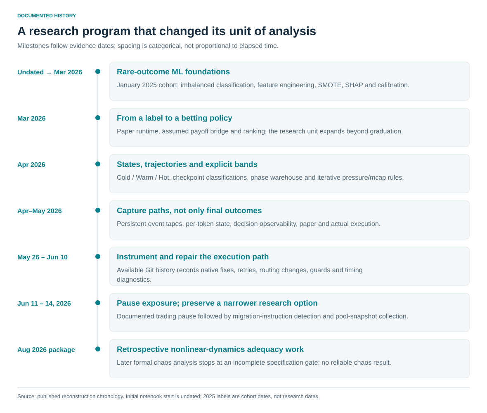
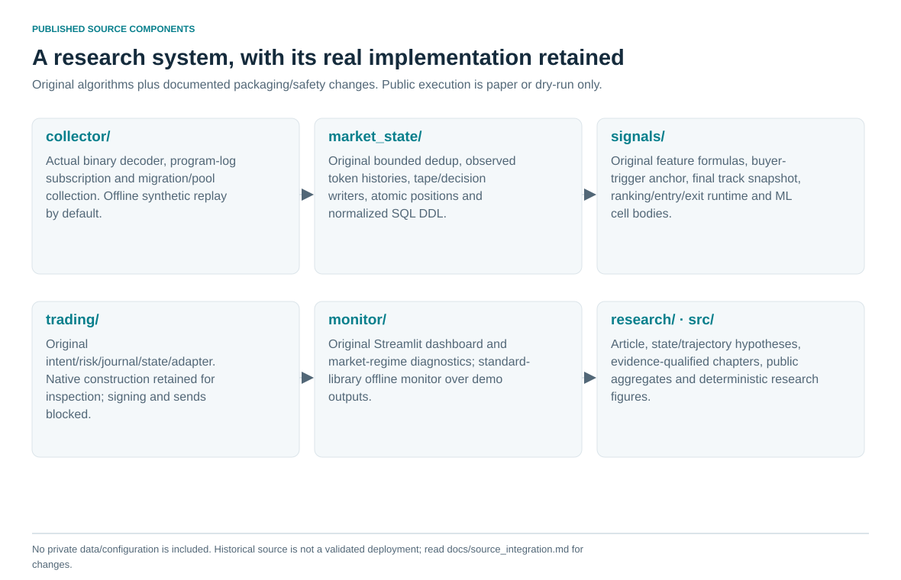
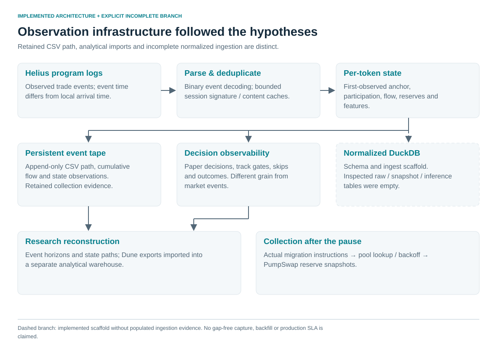

# From Machine Learning to Chaos Theory
### A Solana Quantitative Research Journey Through Phase Space, Market Data Engineering, and Execution Constraints

**How does an early-token classification experiment become a research system—and what changes when the system must observe and execute in a real market?**

This independent research program started with rare-event prediction on Pump.fun tokens. It evolved toward nonlinear-dynamics-inspired state representations, changing market hypotheses, custom Solana event collection and instrumented execution. I eventually paused trading exposure while preserving a narrower data-collection experiment.

The contribution is the research process: explicit hypotheses, mathematical definitions, implementation, revisions, empirical observations and engineering decisions. This repository publishes that work alongside the sanitized original engineering implementation: collection, observed state, signals, trading/risk, and monitoring. Offline replay and dry-run execution are supported; live signing, wallet access and transaction submission are hard-disabled.

**[Read the long-form article →](ARTICLE.md)** · [Reproduce the public analyses](docs/reproducibility.md) · [Explore the architecture](docs/architecture.md) · [Evidence and provenance](docs/evidence_and_provenance.md) · [Editorial handoff](docs/editorial_review.md)



## What the research established

| Finding | Meaning and boundary |
|---|---|
| **32,000 training rows; 583 positives** | Rare graduation-proxy labels in a curated January 2025 cohort. SMOTE, SHAP and average-precision evaluation were executed; evaluation was exploratory. |
| **2,100 checkpoint classifications reproduced** | Four-axis Cold/Warm/Hot implementation across 300 tokens. The separate five-axis proposal remained a research specification. |
| **Descriptive phase/outcome separation** | Retained January and February cohorts show increasing graduation rates from Cold to Warm to Hot. The cohorts differ; this is an association. |
| **3,360 paper exit rows, including one duplicate ID** | Nominal simulated outcomes across changing policies; 3,359 distinct IDs under the documented rule. |
| **188 completed live pairs; −$166.90** | Current reconstructed logged-USD accounting, not a complete wallet/fee reconciliation. The earlier 173–174-trade headline does not fully reconcile. |
| **3.721s median BUY timing** | Signal to local confirmation in 39 selected diagnostics; not complete market-event-to-inclusion latency. |
| **June 11, 2026 trading pause** | A documented decision to stop that trading exposure; data collection continued afterward. |

Deterministic chaos was **not established**. Phase geometry did not receive an independent, cost-aware incremental-value validation. Positive paper summaries and negative live outcomes do not identify a causal execution tax. These distinctions are part of the research, with details in [limitations](docs/limitations.md).

## The state-and-trajectory hypothesis

Tokens approaching graduation might trace similar paths through a multidimensional market-state space. The research asked whether the direction and sequence of those paths could add information beyond a static snapshot. Cold/Warm/Hot regions made that hypothesis operational; the four-axis checkpoint implementation and five-axis proposal remained distinct. Chaos theory informed this approach; deterministic chaos was not established.

On June 11, 2026, I paused the pre-migration trading exposure because further validation and infrastructure work no longer appeared justified relative to expected incremental benefit, capital risk and opportunity cost. Data collection continued for a narrower post-migration research option. This is a documented pause plus a qualitative allocation judgment, not a quantified optimal-stopping result.

## Published engineering system



| Component | Actual source and entrypoint | Public behavior |
|---|---|---|
| [collector/](collector/) | Original binary parser and migration/pool collector | Synthetic replay by default; read-only network mode requires explicit opt-in |
| [market_state/](market_state/) | Original dedup, token reconstruction, event/decision writers and normalized SQL DDL | Local state/tape persistence; no private DB |
| [signals/](signals/) | Original features, buyer-trigger anchor, final policy snapshot, full ranking/entry/exit runtime and ML experiment cells | Historical algorithms with documented extraction/packaging changes; no trained artifact |
| [trading/](trading/) | Original intent, risk, position, pending-exit, journal and dry-run adapter; native construction retained | Paper default; actual dry-run path tested; live send/signing blocked |
| [monitor/](monitor/) | Original Streamlit dashboard and offline CLI; original market-regime diagnostics retained | Local read-only observation; no private process control |
| [research/](research/), [src/](src/) | Case study, mathematical methods, verified aggregates and figure generation | Original research reproduction preserved |

The [source integration record](docs/source_integration.md) identifies retained implementations, precise publication changes and exclusions. The [setup guide](docs/system_setup.md) covers optional dependencies, collector and dashboard commands. Historical comments/parameters describe experiments, not validated performance or a ready-to-deploy strategy.

### Run the system offline

```sh
python3 -S -m collector --demo
python3 -S -m trading --demo
python3 -S -m monitor --demo
python3 -S -m unittest discover -s tests -v
```

These commands use the actual parser/state/feature/risk/dry-run code on synthetic inputs and need no packages, endpoints or wallets. Outputs are ignored under `.runtime/`. The 16 original research tests are preserved, alongside 17 engineering tests. Optional full historical modules use `requirements-engine.txt`; SMOTE/SHAP extras are separate and were not installed or retrained for publication.

## Technical contributions

- **Rare-event ML:** feature construction, imbalance handling, explanation, threshold exploration and recognition of validation limits.
- **Market-state research:** explicit normalized coordinates, region boundaries, trajectory hypotheses and a distinction between implemented rules and proposals.
- **Hypothesis-driven data engineering:** event parsing, per-token state, persistent tapes, schema/provenance work and decision observability.
- **Execution systems analysis:** intent/risk/state separation, native transaction mechanics, retries, recovery and timing boundaries.
- **Research software:** deterministic SVG figures, aggregate verification, synthetic method fixtures, provenance fingerprints and standard-library tests.



## Run offline

Python **3.9 or newer** is sufficient. No package installation, credentials, wallet, API or private file is required. From the repository root:

```sh
python3 src/reproduce.py --check
python3 -m unittest discover -s tests -v
```

To regenerate the expected public calculations and eleven SVG figures:

```sh
python3 src/reproduce.py
```

Public reproduction covers aggregate arithmetic, unit conversions, figure generation and the checkpoint method on **eight explicitly synthetic cases**. It does not recreate the 32,000-row model fit, the historical 2,100-row classification check, live trade matching or timing percentiles from raw data. Those remain supported by the completed private reconstruction. See the [reproduction matrix](docs/reproducibility.md#what-is-reproduced).

## Public/private boundary

Included: sanitized aggregate evidence, documented mathematical and policy definitions, conceptual architecture diagrams, synthetic method examples, reproducible figures and tests. Original event/transaction records, wallet identifiers, credentials, operational configurations, model artifacts and private datasets remain excluded. Public checks reproduce the included arithmetic and methods; they do not independently rerun private historical extraction, model fitting or trade matching.

## Explore the research

| Chapter | Focus |
|---|---|
| [1. Research question](research/01_research_question.md) | Four different targets: labels, price paths, executable returns and portfolio outcomes |
| [2. ML foundations](research/02_ml_foundations.md) | Imbalance, SMOTE, SHAP, average precision and exploratory validation |
| [3. Phase space](research/03_phase_space_and_dynamical_systems.md) | Exact coordinates, hypotheses, observed separation and chaos limits |
| [4. Hypothesis evolution](research/04_hypothesis_evolution.md) | Bands, pressure floors, stake reversal and risk changes |
| [5. Collection engineering](research/05_data_collection_engineering.md) | Why the research needed its own event and decision records |
| [6. Trading experiments](research/06_trading_experiments.md) | Distinct modes, accounting definitions and negative findings |
| [7. Execution and infrastructure](research/07_execution_and_infrastructure.md) | Measured timings, retry mechanics and competitive interpretation |
| [8. Conclusions](research/08_conclusions_and_open_questions.md) | The pause, opportunity cost and unresolved scientific questions |

The [figure guide](figures/README.md) explains which visuals are observational, specification-based or conceptual. The [methodology](docs/methodology.md) defines units and denominators. [LICENSE](LICENSE) applies to contributed source/documentation; [LICENSE_REVIEW.md](LICENSE_REVIEW.md) records attribution and exclusions. Private datasets, funded configuration and original repository histories are not distributed.
