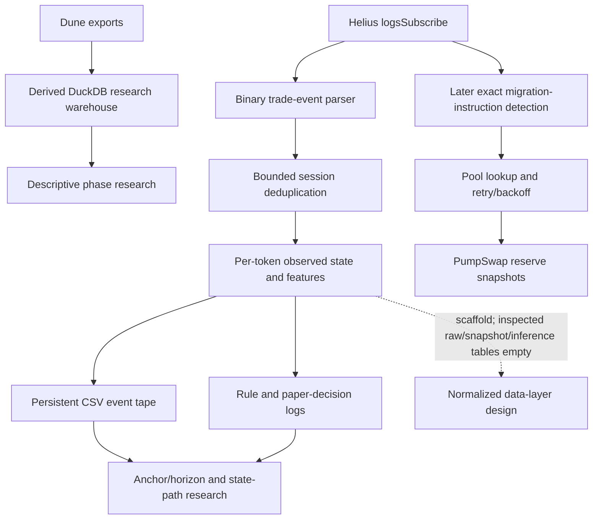
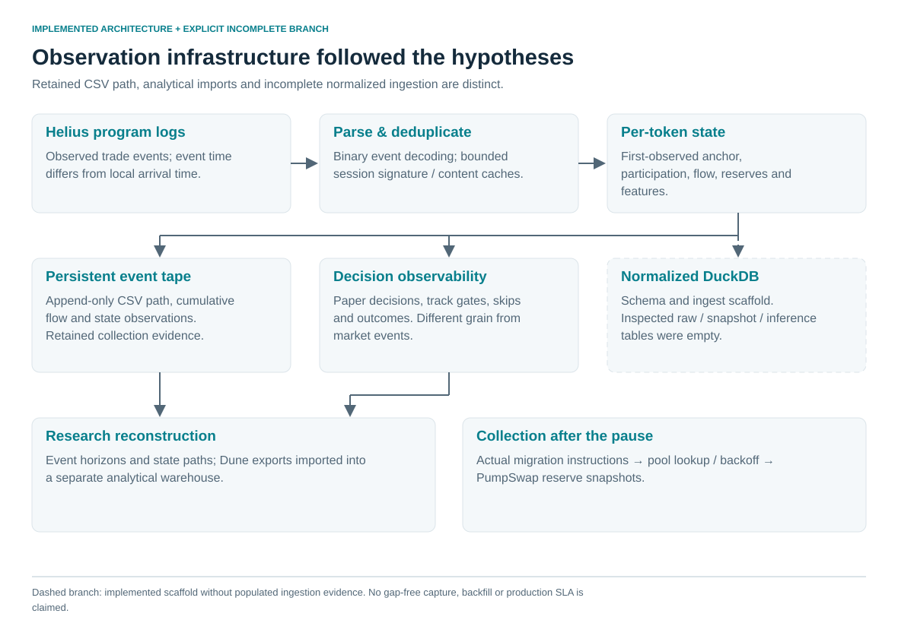
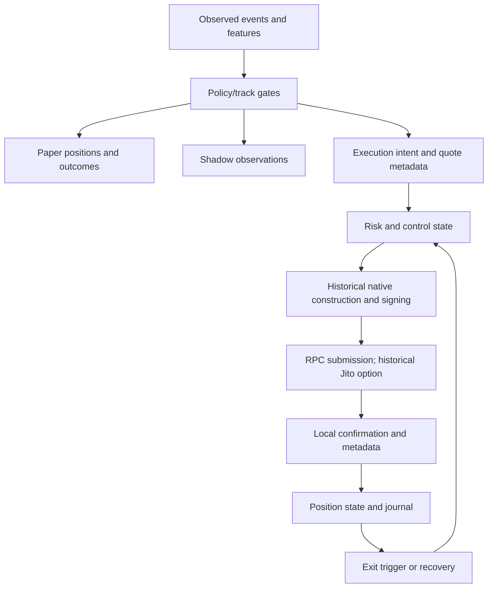
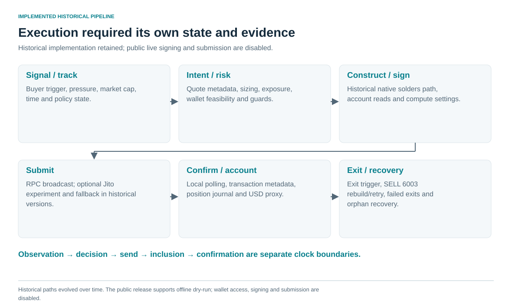

# Architecture: hypotheses determined what had to be retained

These diagrams describe the historical system. The public repository now includes its sanitized implementation with operational offline replay/dry-run paths and explicitly gated read-only collection. Signing, wallet access and transmission are disabled. See [source integration](source_integration.md) and [setup](system_setup.md).

## Collection and research

The event tape observes market paths; rule logs observe software decisions. They must not be counted as interchangeable market observations. The warehouse reconciles analytical imports, while the normalized data-layer bridge has a different evidence status. Solid arrows show implemented mechanisms, not guaranteed complete coverage.

## Execution and state

The key engineering boundary is intent versus outcome: a signal can be selected, denied, fail construction/submission, land at a changed price or remain open. Journals and state transitions made those distinctions observable. Guards, retry policies and routing changed over time; the diagram is a system-level synthesis, not a claim that every historical order had every later protection.

## Public software boundary

`data/` contains aggregates, documented specifications and synthetic method cases. `src/phase_space.py` implements normalization/classification and a separate proposed trapezoid. `src/reproduce.py` verifies input fingerprints and aggregate arithmetic. `src/visuals.py` renders deterministic SVGs. The sanitized historical packages add actual parser/state/signal/risk/dry-run implementations and optional read-only clients. Native transaction construction is retained behind hard execution blocks. No serialized estimator, private state, private-file lookup or signing material is included.
