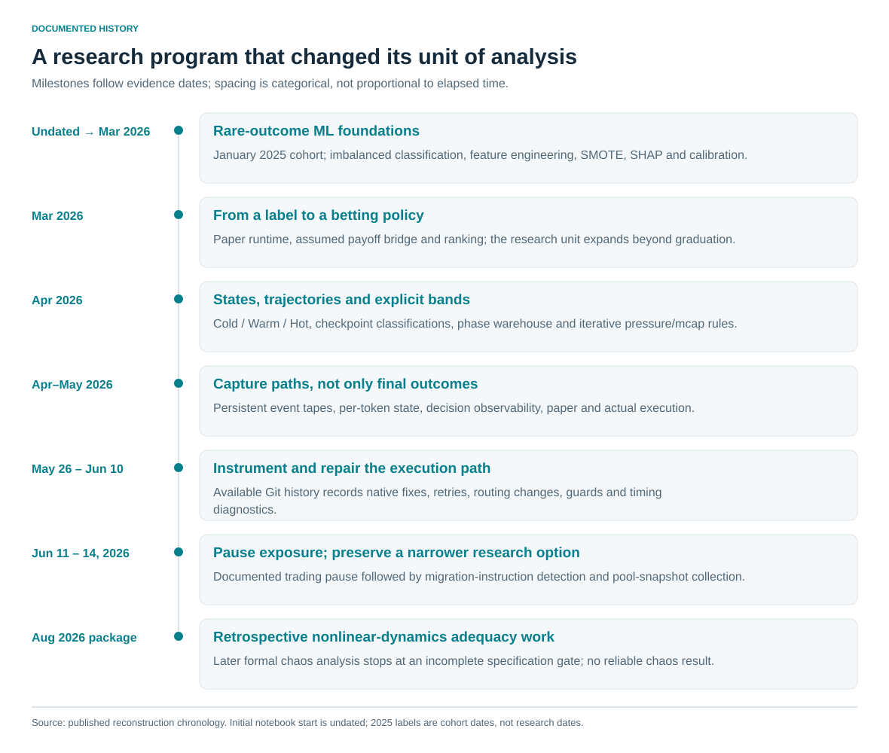

# 1. The question changed as the system became more concrete

The initial question was narrow: could activity observed near the beginning of a Pump.fun token's life help classify a rare graduation outcome? The retained January 2025 analytical cohort had 32,000 rows and 583 positives. January is the cohort date; the initial notebook's exact research start is undated. By March 2026 a paper runtime was present. [E01–E08](../docs/claim_register.md#e01)

The market question was broader than the statistical label. Early demand might indicate participation developing into a larger event, but the cost and timing of entering that event could change its value. Research therefore moved from a classifier toward ranking, market-state descriptions and explicit policy regions.

| Target | Formal question | Required evidence |
|---|---|---|
| Graduation label | P(Y=1 given information at anchor) | Correct observation windows, future-only labels, independent validation |
| Price path | Distribution of future prices or returns over a horizon | Timestamped paths, consistent anchors, censoring rules |
| Executable return | Return of a finite order conditional on state and delay | Order size, liquidity, costs, failures and entry/exit mechanics |
| Portfolio outcome | Economic result under capital and operational constraints | Positions, cashflows, fees, missed orders, exposure and accounting |

The first model could address the first target. An assumed-payoff bridge could explore the relationship to the others, but could not collapse them into one prediction task. This distinction drove the architecture: final token labels were insufficient, so persistent event paths and decision records became research inputs.

The research program can be read as a sequence of changing units of analysis: token → early feature snapshot → state → trajectory → policy decision → execution attempt → economic outcome. Each transition required new data and a more precise definition of what counted as an observation.

The subsequent chapters preserve that evolution. They report the completed reconstruction rather than proposing another trading-viability investigation. The central question of this publication is what was learned and built as the research moved through those units.
