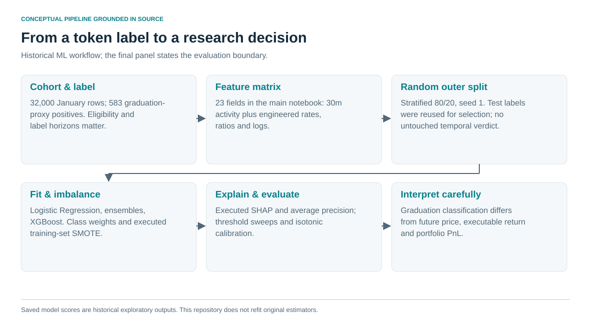

# 2. Rare-event ML foundations

The class prevalence was 583/32,000 = **1.821875%**. An always-negative predictor would have 98.178125% accuracy. Average precision, recall, precision and threshold behavior were therefore more informative than accuracy alone. [E01–E06](../docs/claim_register.md#e01)

The main notebook used 23 features: activity and participation in the first 30 minutes, concentration and size measures, launch calendar fields, and engineered rates/ratios/log transforms. The source dataset also contained two-hour fields; those were not part of that particular 23-column model. A separate temporal-evaluation script used a different feature list. Ten-minute checkpoints belong to later state/outcome work, rather than a uniformly implemented initial ML window.

Logistic Regression, tree ensembles and XGBoost were executed. Class weighting and SMOTE addressed imbalance; SMOTE resampled the training split, and models were refitted. SHAP TreeExplainer and summary/dependence plots were executed. The implemented score called “PR-AUC” was `average_precision_score`, not necessarily trapezoidal area under a precision–recall curve.

| Historical saved baseline | Recall | Precision | ROC-AUC | Average precision |
|---|---:|---:|---:|---:|
| Logistic Regression | .863 | .269 | .931 | .526 |
| Gradient Boosting | .667 | .951 | .960 | .812 |
| XGBoost | .667 | .765 | .966 | .782 |

These are saved exploratory outputs supported by private notebook inspection. This repository does not retrain the models or distribute the underlying token dataset or serialized estimators. [E03](../docs/claim_register.md#e03)

The outer split was random, stratified, 80/20, seed 1. The same test labels were reused in model comparison, threshold searches and structural-filter experiments. Later XGBoost tuning used three-fold CV, and isotonic calibration was fitted on balanced data. Resampling before an inner CV can contaminate its fold boundary; calibration on altered prevalence also differs from deployment calibration. The resulting evidence supports an exploratory ML study, rather than an untouched temporal test.

Feature semantics became an equally important issue: a trade-count ratio is not a volume ratio; buy-side concentration is not all-side concentration. Similar column names concealed differences between historical descriptions and runtime builders. This motivated explicit units, schema versions and anchor definitions in later engineering work.

The first-person lesson is concrete: model explanation, imbalance treatment and high selected thresholds did not remove the need to define information time and keep selection separate from evaluation. Public fixtures reproduce the class-prevalence arithmetic; historical model performance is documented, not independently refitted here.
