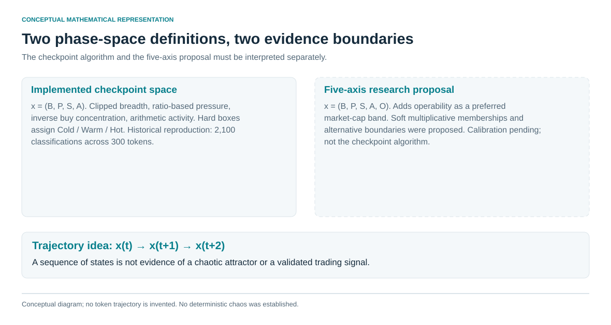
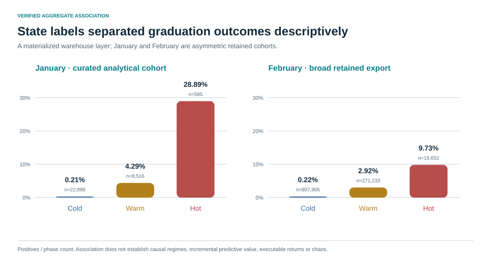

# 3. Market states and trajectories

The phase-space hypothesis treated a token as a joint configuration: participation breadth, directional pressure, internal structure, activity and operability. The economic intuition was that broad demand with sustained flow is different from isolated volume, and that an attractive configuration can deteriorate or become expensive before an order reaches it. [E09–E12](../docs/claim_register.md#e09)

## Four-axis checkpoint implementation

For q(z)=min(1,max(0,z)), the implementation used:

$$B=q((u-20)/80),\qquad P=q(r-1),\qquad S=1-q((c-.20)/.30),$$
$$A=.5q((v-1000)/9000)+.3q((n-20)/180)+.2q((a-20)/100).$$

Here u is distinct buyers, r the checkpoint buy/sell ratio, c top-wallet buy-volume share, v total USD volume, n trade count and a mean USD size, all to the checkpoint. Hot requires B≥.60, P≥.35, S≥.40, A≥.35. Cold requires B≤.20, P≤.20, A≤.25; otherwise the classification is Warm. Missing comparisons can become residual Warm, although missing S alone need not prevent Cold. The public wrapper flags missing inputs rather than treating a phase label as data-quality assurance.

All **2,100 classifications across 300 tokens** at 1,3,5,10,15,20,30 minutes reproduced in the private reconstruction. Counts are repeated checkpoint observations: Cold 792, Warm 1,214, Hot 94. Public code implements the documented formula on synthetic examples, not the withheld historical rows. [E10](../docs/claim_register.md#e10)

## Five-axis research proposal

The separate proposal used x=(B,P,S,A,O). Pressure could use normalized buy-volume share or a composite; activity could be geometric; operability O was a trapezoid with proposed market-cap knots $10k,$14k,$22k,$30k. Candidate membership functions were:

$$H=B^{.25}P^{.30}S^{.15}A^{.20}O^{.10},$$
$$C=(1-B)^{.30}(1-P)^{.35}(1-A)^{.20}(1-S)^{.15},\qquad W=1-\max(C,H).$$

These are membership scores, not calibrated probabilities, and need not sum to one. The specification offered argmax and threshold alternatives and remained calibration pending. It must not be substituted for either the checkpoint algorithm or the materialized warehouse layer's incompletely recovered generating lineage.

## Trajectory hypotheses and observations

Cold→Warm→Hot represented activation; Warm→Cold failed activation; Hot→Warm/Cold degradation. A proposed directional displacement score was .25ΔB+.35ΔP+.25ΔA+.15ΔS. Without division by unequal time gaps, this is not a physical velocity. Runtime “buyer velocity” instead counted distinct buy wallets in the last minute; “acceleration” subtracted the prior minute's count.

The retained materialized warehouse separates graduation labels descriptively in January and February. January is curated and February broader; aggregate associations are reproducible from public counts. A held-out ablation establishing added trajectory value over simpler breadth/pressure rules was not completed. [E11–E12](../docs/claim_register.md#e11)

Using state space does not establish chaos. Seven checkpoints cannot support attractor or invariant inference. A later retrospective adequacy analysis stopped because variance-regime and downstream method choices were not fully frozen; no reliable D2, Lyapunov or IAAFT result was produced. Nonlinearity, stochastic dynamics, regime switching and deterministic chaos remain distinct propositions. [E23–E24](../docs/claim_register.md#e23)
