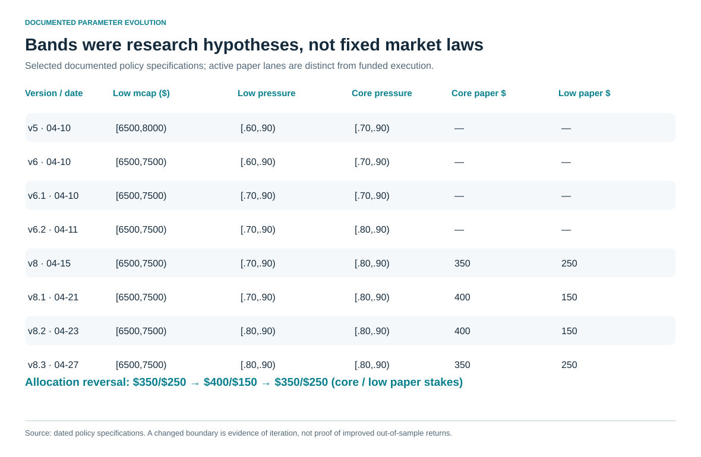

# 4. Hypotheses became parameters—and parameters changed

The investment hypothesis shifted from “a likely graduate deserves a high expected payoff” toward “a particular configuration may offer a short, executable opportunity.” Explicit market-cap regions, participation gates, pressure floors and exits made that hypothesis operational. [Policy provenance](../docs/evidence_and_provenance.md#policy-specifications)

The early phase formulation used 60 buyers, a clean trade of at least $100, and a 2x/10-minute payoff experiment. Later policy families often used buyers≥40, a 1.5x take-profit and an eight-minute timeout. These were different versions and anchors, not one immutable strategy.

The low lane narrowed from [$6,500,$8,000) to [$6,500,$7,500), moving the intermediate region into shadow observation. Its pressure floor rose from .60 to .70 and later .80. The [$8,000,$9,000) core floor rose from .70 to .80. Shadowing a region preserved observation while changing the active policy—a useful separation of learning from action.

Allocation did not move in one direction. April 21 increased nominal core paper stake from $350 to $400 and reduced low from $250 to $150. April 27 reversed that preference to $350/$250 after another recent paper read. The reversal is part of the experiment history: confidence depended on the observed window, rather than every revision being a demonstrated improvement.

Risk and execution changed on a separate track. Late-May repair sizing used $2.50; a later $25 pilot was reduced to $15. The June fast-stop trigger tightened from −25% to −15%; entry-premium guards, time limits and routing changes followed. Those funded sizes must not be confused with the much larger paper allocations.

The geometric proposal's higher operability trapezoid and later lower-cap policy lanes also came from different analyses. Presenting them as one calibrated coordinate would invent continuity that the evidence does not provide.

Most choices followed historical slicing, then prospective operation. That is iterative research, with multiple-testing and regime-dependence limits. There was no completed controlled study showing that each tightened band improved outcomes independently of time, other policy edits or sample selection. The [CSV](../data/policy_evolution.csv) records specifications, with empty stake fields meaning “not encoded in this selected table,” not zero size.
