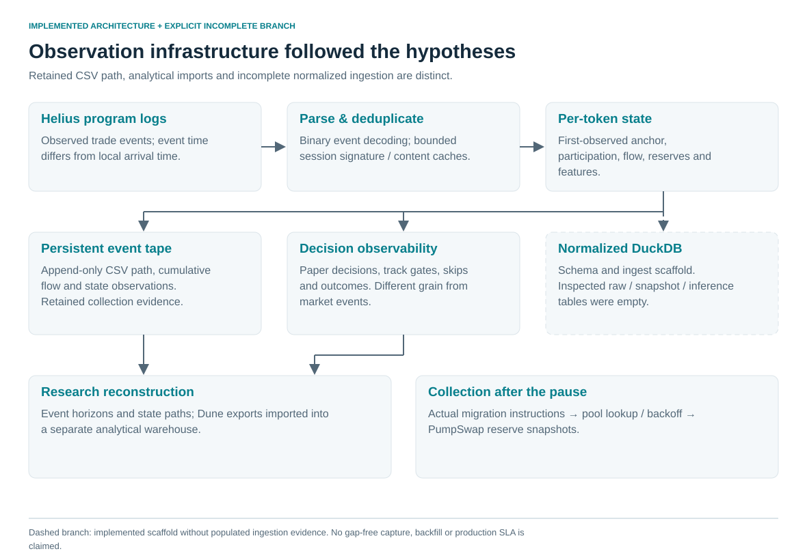

# 5. The research needed its own observation layer

A final graduation label cannot tell us how the token moved through states, when information became observable, why a policy skipped it, or whether its future path was reachable by an order. Those questions required persistent, hypothesis-specific data rather than another static export.

The operating collection path decoded binary trade events from Helius program-log subscriptions, maintained per-token observed state and appended a CSV event tape. The tape retained reserve-derived price, cumulative participation/flow, token age and timestamps. Rule observability and paper decisions recorded a different grain: evaluations and actions rather than market events. Outcome Engine work aimed to reconstruct anchor-to-horizon behavior and distinguish selection, entry and exit regret. [E25–E27](../docs/claim_register.md#e25)

| Research need | Engineering response | Constraint exposed |
|---|---|---|
| State at an information boundary | Per-token state and anchored features | First observed trade may be later than token creation |
| Trajectories after decisions | Persistent event tape and horizon research | Event-time density, gaps and selection vary |
| Why a signal was not acted upon | Rule-evaluation and decision logs | Repeated evaluations are not independent market observations |
| Equivalent features across sources | Canonical units, schema/parser versions and anchor definitions | Buy-only versus all-side quantities can differ despite similar names |
| Behavior after migration | Actual migration-instruction detector and pool polling | Market-cap threshold is not migration ground truth |

The normalized DuckDB design separated event time, observation time and ingestion time, integer lamports, token units, parser versions, snapshots and labels. The inspected DB had populated labels but empty raw/snapshot/inference tables. The distinction is intentional in the diagram: schema/integration work was implemented, but successful normalized ingestion is not established by the inspected database. The retained CSV path is stronger operational evidence.

Later session-local signature/content caches reduced redelivery. Their bounded memory and restart behavior limited historical deduplication; a signature alone can hide multiple relevant events, while a same-second content key can collide. A proposed stronger design would identify signature plus instruction/event index, but this publication does not retroactively claim that design was deployed.

A reserve-ratio price is marginal post-trade price, not an average finite-order execution. Runtime USD conversion depends on an oracle quote. Missing early history changes ages and participation, while event time is not arrival time. The architecture made these distinctions visible instead of treating a large CSV as self-validating.

After the pause, collection continued with actual Migrate/MigrateV2 instruction detection, mint/pool extraction, pool lookup backoff and PumpSwap reserve snapshots. Program-ID and proxy corrections are documented engineering iterations. The later checkpoint's economic result remains unknown; the concrete contribution here is the observation mechanism. [E22](../docs/claim_register.md#e22)
