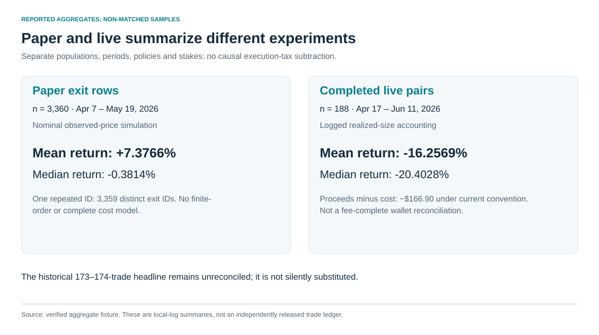

# 6. Research modes and observed outcomes

Simulation, paper, shadow, dry-run and funded execution answer different questions. A policy document calling a lane “live” may mean active paper selection; funded events are specifically recorded as micro-live. In the public repository all modes are historical descriptions, with no operational implementation.

| Mode | What was exercised |
|---|---|
| Notebook/backtest | Predictions, ranking, assumed payoffs or historical paths |
| Paper | Decisions and exits against observed-price proxies |
| Shadow | Alternate policy observations outside an active lane |
| Dry-run | Intent and execution-path behavior without funded submission |
| Micro-live | Actual transactions, position tracking, retries and outcomes |

The original paper v2 file has 3,360 final exit rows, one repeated ID and 3,359 distinct IDs under last-exit deduplication. Raw-row mean return is +7.3766%, median −0.3814% and positive fraction 49.6429%. The paper stakes and policy mix changed. These are nominal observed-price simulations, not a finite-order net-return ledger. [E13–E14](../docs/claim_register.md#e13)

The current reconstruction matches 188 filled BUY/SELL pairs from April 17 through June 11, 2026. Logged proceeds minus logged cost total **−$166.90**. Two filled buys remain unmatched. The convention uses realized-size USD derived from wallet deltas and contemporaneous SOL quotes; fees, rent, refunds, fallback values and open exposure prevent interpreting it as a complete fee-clean wallet reconciliation. [E15](../docs/claim_register.md#e15)

The earlier 173–174-trade headline and its reported total do not fully reconcile. They remain a historical reporting limitation, rather than a figure to silently replace. Different dollar and equal-return profit-factor weightings also answer different questions under variable stakes. [E16](../docs/claim_register.md#e16)

There are 5,079 failed SELL rows, many representing repeated retry/event records. That count is not the number of failed independent trades. The logged slippage proxy takes an absolute price deviation, mixing favorable and adverse moves; it is not a pure adverse execution-cost estimate. [E18–E19](../docs/claim_register.md#e18)

Positive paper summaries and negative logged live results expose a gap between modeled and realized behavior. They do not identify its causal decomposition: dates, sizes, rules, arming, uptime and selection differ. The publication retains that negative finding without turning two unmatched populations into an estimated execution tax.
