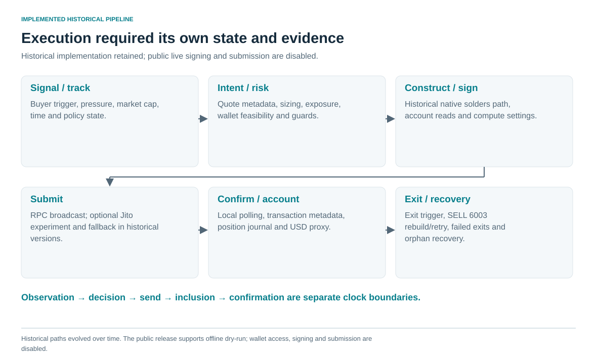
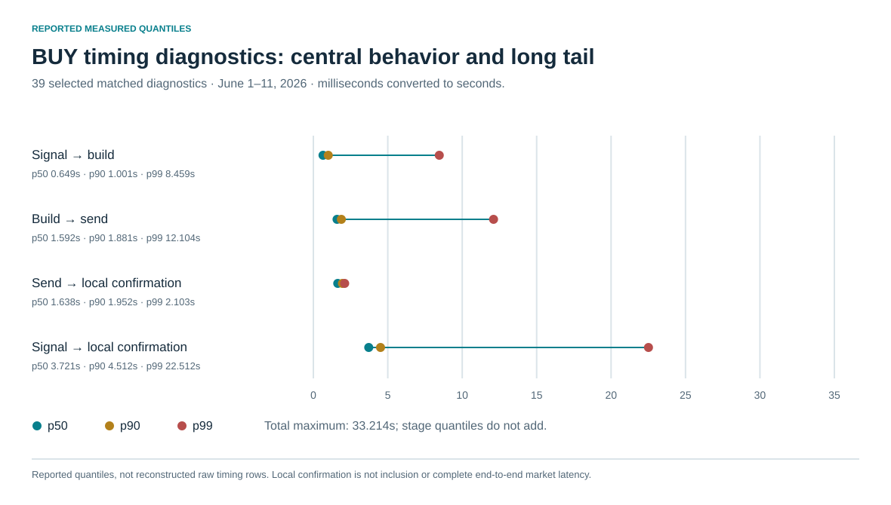

# 7. Timing became a measured research variable

The historical stack separated policy decision, execution intent, risk, construction/signing, submission, confirmation and position state. Native construction used solders primitives and compute-budget settings. Journals/recovery supported failed exits and orphan positions. SELL error 6003 rebuilt against refreshed curve state; that mechanism could trade completion probability against additional delay during a collapse. [E17–E22](../docs/claim_register.md#e17)

Git records native instruction/parsing repairs, parallel account reads and RPC broadcast, Jito experimentation then disabling, and entry/age guards. A 1000x unit correction in the entry-premium guard illustrates why correctness must be distinguished from network latency. The local Jito history is not a comparative provider benchmark. [E20](../docs/claim_register.md#e20), [E28](../docs/claim_register.md#e28)

The strongest timing evidence is 39 selected matched BUY diagnostics from June 1–11: signal-to-local-confirmation median **3.721s**, p90 **4.512s**, interpolated p99 **22.512s**, maximum **33.214s**. The source field was named `signal_to_fill_ms`, but its endpoint is the local confirmation timestamp. Stage quantiles do not add, and a 39-row p99 is a thin-tail descriptive statistic rather than a service-level guarantee. [E17](../docs/claim_register.md#e17)

Complete market-event-to-arrival, signal-computation, signing-only and submission-to-inclusion distributions were not established. Case narratives describe difficult SELL retries, but they are not a full-sample SELL latency benchmark. The retained [histogram](../figures/retained_latency_distribution.png) shows the original selected diagnostic distribution; the raw rows are not distributed here.

Infrastructure and competition are relevant mechanisms, with precise attribution still unresolved. Delayed entry, difficult exit liquidity, fees, optimistic paper fills, code defects and selection all coexist. The informal 90% / 8% / 1% hierarchy was qualitative, not a measured participant distribution. It motivates questions about the cost of reaching the next level of execution capability; it does not establish superiority over ordinary traders or market-wide profit concentration. [E32](../docs/claim_register.md#e32)
