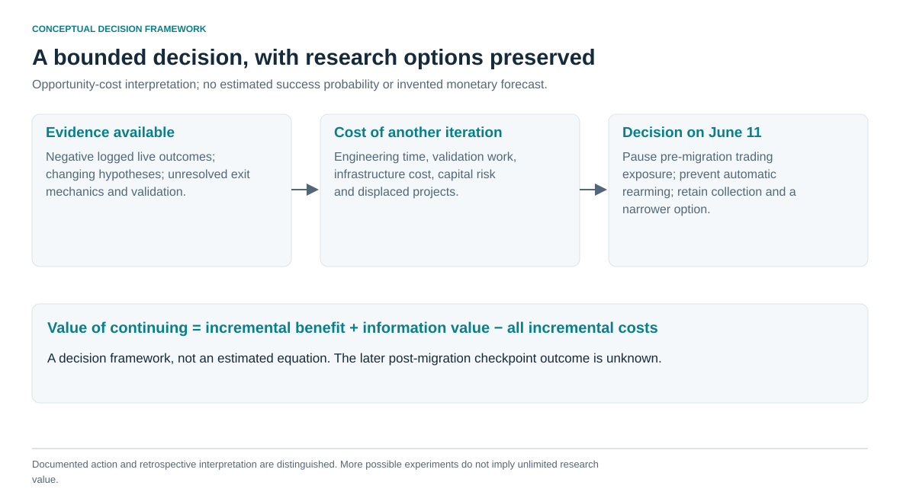

# 8. A research decision with explicit scope

On June 11, 2026, the trading gate closed and a watchdog change prevented automatic rearming. Collection continued, followed by a narrower post-migration observation experiment. That is the documented scope of the pause. It was neither a claim that every Solana hypothesis was exhausted nor evidence of a permanently closed research program. [E21–E22](../docs/claim_register.md#e21)

My interpretation is that further capital and open-ended engineering effort no longer appeared justified by the expected incremental benefit. More bands, state definitions and infrastructure changes remained possible. Each also required validation, operational work and attention that could be used elsewhere. This is an opportunity-cost judgment, not an estimated optimal stopping time or numerical value-of-information result.

Three lessons carry forward. First, information available at an anchor needs a precise definition before modeling. Second, software should retain the observation, decision and execution identities needed to answer the actual hypothesis. Third, correctness, predictive association, execution quality and economic results are different evidence layers.

## Scientifically unresolved

- Whether trajectories add predictive or economic information beyond simpler breadth/pressure/mcap baselines under independent temporal testing.
- How much descriptive phase separation survives strict future-only labels, cohort alignment and feature-definition consistency.
- Whether retained event series can support reliable nonlinear-dynamics inference under a fully specified protocol. Deterministic chaos was not established.
- A matched, all-cost causal decomposition of paper/live differences and complete end-to-end timing.
- Exact reconciliation of the older 173–174-trade report and the later post-migration checkpoint outcome.

These gaps bound the conclusions of the completed work. Resolving them is not required to reproduce this repository's public aggregates or to discuss its engineering contributions. No new strategy-viability investigation is performed here.

The portfolio contribution is a research system with visible assumptions and corrections: imbalanced ML, interpretable state geometry, changing hypotheses, custom collection, execution instrumentation and a documented allocation decision. Its negative findings belong in that record alongside the implemented mechanisms.
